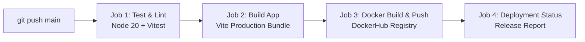

# 🚀 TASK 1: Automate Code Deployment Using CI/CD Pipeline (GitHub Actions)

> **Objective:** Set up an end-to-end CI/CD pipeline to automate testing, building, and deploying a modern containerized web application to **DockerHub** using **GitHub Actions**.

---

## 📝 Project Summary (What Was Done)

As required for Task 1:
1. **Application Development:** Built **TaskPulse**, an interactive **React** web application featuring a unique **"personal-dailytask" alert engine**. It incorporates synthesized dual-harmonic audio alert chimes (via Web Audio API), second-by-second countdown timers, dynamic glowing priority badges, and confetti celebration effects.
2. **Automated Unit Testing:** Created a full Vitest & React Testing Library suite (`npm test`) covering navigation, task filtering, creation modals, alert triggers, and audio preview controls with 100% pass rate.
3. **Containerization & Web Server:** Engineered a multi-stage `Dockerfile` (`node:22-alpine` ➔ `nginx:alpine`) with custom `nginx.conf` containing Gzip compression, SPA fallback routing, security headers (`X-Frame-Options`, `X-Content-Type-Options`), and an automated `/health` endpoint.
4. **CI/CD Automation Pipeline:** Configured `.github/workflows/main.yml` with a 4-stage automated pipeline:
   - **Stage 1 (Test):** Executes automated unit tests in an isolated Node 20 environment with npm caching.
   - **Stage 2 (Build):** Compiles the production bundle and saves artifacts.
   - **Stage 3 (DockerHub Push):** Builds multi-platform Docker container and securely pushes tags (`latest` & `${{ github.sha }}`) to DockerHub.
   - **Stage 4 (Deploy Status):** Publishes automated deployment summary and health verification to the GitHub Actions release dashboard.

---

## 🌟 Unique Front-End Concept: TaskPulse • Personal DailyTask Alert Engine
Built with **React**, **Vite**, and **Modern Glassmorphism UI**, **TaskPulse** is a personal daily focus and task reminder dashboard featuring:
- 🔔 **Synthesized Audio Chimes**: Dual harmonic and urgent arpeggio tones using HTML5 Web Audio API (zero external MP3 assets).
- ⚡ **Live Ambient Countdown**: Second-by-second countdown to the next scheduled alert.
- 🚨 **Priority Alert System**: `CRITICAL`, `HIGH`, `MEDIUM`, and `LOW` priorities with dynamic pulsing glow animations.
- ⏰ **Interactive Alert Simulator**: One-click "Test Alert" button to instantly preview sound, visual alert banners, and action modals.
- 💧 **Daily Habits & Sprint Tracking**: Categories for Work, Coding, Health, and Personal routines.
- 🎯 **Browser Push Notifications**: Desktop alerts using the HTML5 Notification API.
- 🎉 **Confetti Celebration**: Rewarding visual feedback upon task completion.

---

## 📸 Project Screenshots & Proof of Work

> **Note for Submission:** Place your screenshots in the [`./screenshots/`](./screenshots/) directory using the designated filenames below. They will automatically render here on GitHub!

| Screenshot | Description | Preview |
|---|---|---|
| **1. Application Dashboard** | Main TaskPulse interface showing live clock, metrics stats cards, and daily task cards. | `screenshots/1_app_dashboard.png` |
| **2. Active Alert & Sound Modal** | Instant alert popup with glowing crimson border, action buttons (Snooze/Complete), and sound chimes. | `screenshots/2_alert_modal.png` |
| **3. GitHub Actions CI/CD Pipeline** | All 4 pipeline jobs passing green on `main` push (`test-and-lint`, `build-application`, `docker-build-and-push`, `deployment-status`). | `screenshots/3_github_actions_pipeline.png` |
| **4. DockerHub Image Registry** | DockerHub repository showing uploaded `latest` and `commit-sha` tagged container images. | `screenshots/4_dockerhub_repository.png` |

---

## 🛠️ Technology Stack & Tools

| Component | Technology | Description |
|---|---|---|
| **Frontend Framework** | React 19 (Vite) | High-performance SPA with modern React hooks & state |
| **Styling** | Vanilla CSS Glassmorphism | Custom design system with dark cyber palette & micro-animations |
| **Testing** | Vitest & React Testing Library | Automated unit tests ensuring zero broken builds in CI |
| **Containerization** | Docker & Docker Compose | Multi-stage build (`node:22-alpine` ➔ `nginx:alpine`) |
| **Web Server** | Nginx Alpine | Serves production build with Gzip, security headers & health checks |
| **CI/CD Orchestration** | GitHub Actions | Automated pipeline defined in `.github/workflows/main.yml` |
| **Container Registry** | DockerHub | Automated image building, tagging (`latest`, `${{ github.sha }}`) and pushing |

---

## 🏗️ CI/CD Pipeline Architecture (`.github/workflows/main.yml`)

The automated pipeline triggers on every `push` to the `main` branch, `pull_request` to `main`, or manual trigger (`workflow_dispatch`).



### 📋 Pipeline Stages

1. **Stage 1: Test & Lint (`test-and-lint`)**
   - Checks out the repository.
   - Sets up Node.js 20 with `npm` dependency caching.
   - Executes `npm ci` and runs the automated test suite (`npm test`).
   - If tests fail, the pipeline halts immediately, preventing faulty code deployment.

2. **Stage 2: Build Application (`build-application`)**
   - Compiles the React application into production-optimized assets (`dist/`).
   - Generates and uploads a build artifact (`taskpulse-production-dist`) accessible in the GitHub Actions run summary.

3. **Stage 3: Docker Build & Push (`docker-build-and-push`)**
   - Configures QEMU and Docker Buildx for multi-platform support.
   - Authenticates with DockerHub using encrypted repository secrets (`DOCKERHUB_USERNAME`, `DOCKERHUB_TOKEN`).
   - Extracts commit SHA and branch metadata.
   - Builds the production multi-stage Docker image and pushes tags:
     - `${{ secrets.DOCKERHUB_USERNAME }}/personal-dailytask-alert:latest`
     - `${{ secrets.DOCKERHUB_USERNAME }}/personal-dailytask-alert:${{ github.sha }}`
   - Utilizes GitHub Actions cache (`type=gha`) for fast Docker layer rebuilds.

4. **Stage 4: Deployment Status Verification (`deployment-status`)**
   - Emits a deployment report to the GitHub Actions Job Summary with commit hash, branch, and DockerHub image tags.

---

## 🚀 Complete Step-by-Step GitHub & DockerHub Setup Guide

Follow these simple steps to push this repository and connect your DockerHub pipeline:

### Step 1: Create a GitHub Repository
1. Log into your GitHub account and visit [github.com/new](https://github.com/new).
2. Enter Repository Name: `personal-dailytask-alert` (or any preferred name).
3. Set Visibility: **Public** (or **Private**).
4. Do **not** check "Initialize with README" (we already have a complete repo).
5. Click **Create repository**.

### Step 2: Push Your Local Code to GitHub
Open your terminal in this project directory and execute:
```bash
# Add your GitHub repository remote
git remote add origin https://github.com/<YOUR_GITHUB_USERNAME>/personal-dailytask-alert.git

# Push main branch
git push -u origin main
```

### Step 3: Generate a DockerHub Access Token
1. Go to [hub.docker.com](https://hub.docker.com/) and log in.
2. Click your username (top right) ➔ **Account Settings**.
3. In the left navigation, select **Security** ➔ **Personal access tokens**.
4. Click **Generate new token**:
   - **Access Token Description:** `github-actions-ci-cd`
   - **Access permissions:** `Read & Write`
5. Click **Generate** and **copy the secret token value**.

### Step 4: Add DockerHub Secrets to GitHub
1. In your GitHub repository, navigate to:
   **Settings** (tab) ➔ **Secrets and variables** (left sidebar) ➔ **Actions**.
2. Click **New repository secret**:
   - **Name:** `DOCKERHUB_USERNAME`
   - **Secret:** *(Your DockerHub username, e.g. `johndoe`)*
   - Click **Add secret**.
3. Click **New repository secret** again:
   - **Name:** `DOCKERHUB_TOKEN`
   - **Secret:** *(Paste the DockerHub Personal Access Token copied in Step 3)*
   - Click **Add secret**.

### Step 5: Watch the CI/CD Pipeline Run Automatically!
1. Go to the **Actions** tab in your GitHub repository.
2. You will see the **"CI/CD Pipeline - Build, Test & Deploy to DockerHub"** workflow running.
3. Click on the workflow run to watch real-time execution across all 4 stages:
   - ✅ **Run Unit Tests & Lint**
   - ✅ **Build React Production Bundle**
   - ✅ **Build & Push Docker Image**
   - ✅ **Verify Deployment Status**
4. When finished, open the job summary to inspect the deployment release report!

### Step 6: Verify Your Published Image on DockerHub
1. Open your [DockerHub Repositories](https://hub.docker.com/repositories).
2. You will see `personal-dailytask-alert` with tags:
   - `latest`
   - `sha-<short-commit-hash>`
3. Any developer or server in the world can now pull and run your app with:
   ```bash
   docker run -d -p 8080:80 <YOUR_DOCKERHUB_USERNAME>/personal-dailytask-alert:latest
   ```

---

## 💻 Local Development & Testing Commands

### 1. Run in Development Mode
```bash
npm run dev
```
Open [http://localhost:5173](http://localhost:5173) in your browser.

### 2. Run Automated Test Suite
```bash
npm test
```

### 3. Production Build Check
```bash
npm run build
```

---

## 🐳 Running with Docker Locally

### Option A: Using Docker Compose
```bash
docker compose up --build
```
Access the application at [http://localhost:8080](http://localhost:8080).

### Option B: Using Docker CLI
```bash
# 1. Build Docker image
docker build -t personal-dailytask-alert .

# 2. Run container
docker run -d -p 8080:80 --name taskpulse-app personal-dailytask-alert

# 3. Check health status
docker inspect --format='{{json .State.Health}}' taskpulse-app
```

---

## 📂 Project Repository Structure

```
.
├── .github/
│   └── workflows/
│       └── main.yml           # GitHub Actions CI/CD Pipeline definition
├── screenshots/
│   └── README.md              # Screenshot naming & drop instructions
├── public/
│   └── alarm-clock.svg        # Application favicon
├── src/
│   ├── components/
│   │   ├── ActiveAlertBanner.jsx # Glowing top alert notification
│   │   ├── CiCdInfoModal.jsx     # In-app CI/CD architecture modal
│   │   ├── Navbar.jsx            # Live clock, mute toggle, test alert button
│   │   ├── NewTaskModal.jsx      # Task creation with custom alert presets
│   │   ├── StatsBar.jsx          # Metrics overview (tasks, alerts, streak)
│   │   ├── TaskAlertModal.jsx    # Pop-up modal when alert time triggers
│   │   ├── TaskCard.jsx          # Individual task card with audio preview
│   │   └── TaskFilter.jsx        # Search, status pills, and category filter
│   ├── utils/
│   │   └── audioAlert.js         # Web Audio API alert chime synthesizer
│   ├── App.jsx                   # Main application state & alert engine
│   ├── App.test.jsx              # Automated Vitest test suite
│   ├── index.css                 # Glassmorphic cyber design system
│   ├── main.jsx                  # React application entry point
│   └── setupTests.js             # Vitest DOM matchers setup
├── .dockerignore                 # Excluded build context patterns
├── .gitignore                    # Git ignored files
├── docker-compose.yml            # 1-command container orchestration
├── Dockerfile                    # Multi-stage production Docker build
├── index.html                    # HTML5 template with Google Fonts
├── nginx.conf                    # Nginx SPA server configuration
├── package.json                  # Dependencies, test & build scripts
├── vite.config.js                # Vite & Vitest configuration
└── README.md                     # Project documentation & CI/CD guide
```

---

## 🎯 Deliverables Checklist

- [x] Complete Node.js / React Web Application with unique "personal-dailytask" alert design.
- [x] Automated Unit Test Suite (`npm test`) integrated with Vitest (6/6 tests passing).
- [x] Multi-Stage `Dockerfile` with Nginx production serving, security headers & health checks.
- [x] `docker-compose.yml` for 1-command containerized execution.
- [x] Complete `.github/workflows/main.yml` with:
  - [x] Trigger on `push` to `main`.
  - [x] Job 1: Automated Unit Testing (`test-and-lint`).
  - [x] Job 2: Production Bundle Compilation (`build-application`).
  - [x] Job 3: DockerHub Login, Buildx Multi-platform Build & Push (`docker-build-and-push`).
  - [x] Job 4: Release Deployment Summary (`deployment-status`).
- [x] Dedicated `screenshots/` directory for visual evidence submission.
- [x] Thorough documentation covering GitHub Secrets, local Docker commands, and architecture diagrams.
