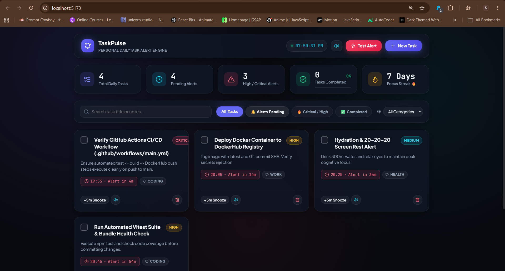
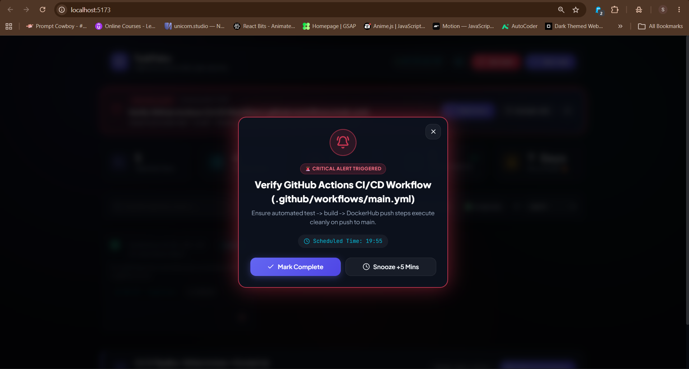
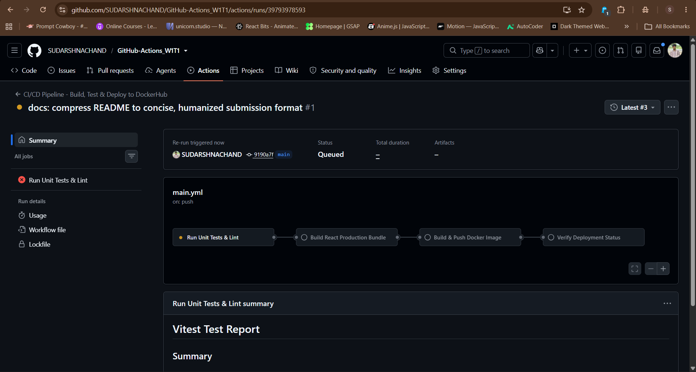
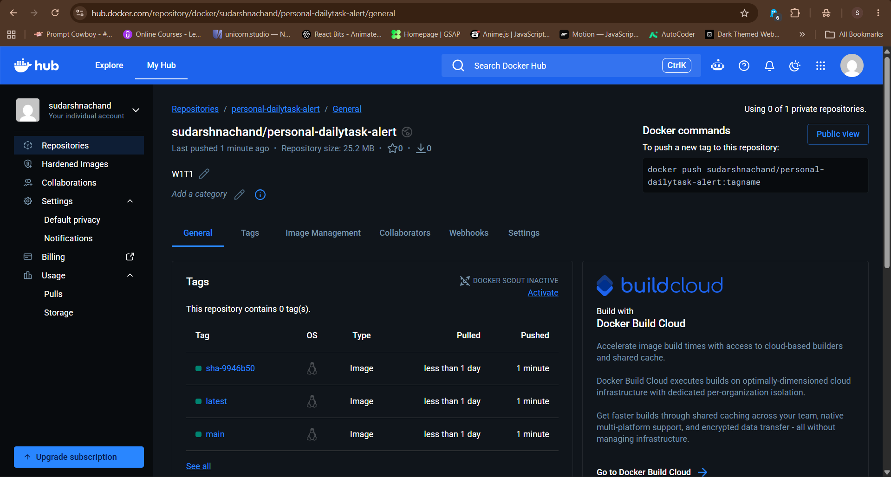

# 📌 Task 1: Automate Code Deployment Using CI/CD Pipeline (GitHub Actions)

Automated end-to-end CI/CD pipeline built for **TaskPulse** — a modern React web application featuring a unique **"personal-dailytask" alert engine**. Every push to the `main` branch automatically tests, builds, and deploys the containerized application directly to **DockerHub**.

---

## ⚙️ Working Procedure: Automate Code Deployment (CI/CD Pipeline)

The automated deployment pipeline ([`.github/workflows/main.yml`](.github/workflows/main.yml)) operates through 4 distinct stages on every push to `main`:

1. **Stage 1: Automated Unit Testing & Linting (`test-and-lint`)**
   - Spins up an isolated Ubuntu runner with Node.js 22 LTS.
   - Installs clean dependencies via `npm ci` with caching.
   - Executes the automated Vitest test suite (`npm test`). If any test fails, the pipeline immediately halts to prevent faulty code from being built or deployed.

2. **Stage 2: Production Bundle Compilation (`build-application`)**
   - Runs `npm run build` using Vite.
   - Compiles and minifies HTML, CSS, and JS into high-performance static assets.
   - Uploads the production `dist/` bundle as an artifact for 7 days retention.

3. **Stage 3: Docker Build & Push to DockerHub (`docker-build-and-push`)**
   - Sets up QEMU (multi-platform support) and Docker Buildx.
   - Authenticates securely to DockerHub using encrypted repository secrets (`DOCKERHUB_USERNAME`, `DOCKERHUB_TOKEN`).
   - Builds the multi-stage Docker image and pushes tags:
     - `sudarshnachand/personal-dailytask-alert:latest`
     - `sudarshnachand/personal-dailytask-alert:<commit-sha>`
   - Leverages GitHub Actions layer caching (`type=gha`) for ultra-fast builds.

4. **Stage 4: Continuous Deployment Status (`deployment-status`)**
   - Publishes a verified deployment report to the GitHub Actions Job Summary showing the commit hash, branch, and DockerHub image URL.

---

## 📸 Project Proof & Screenshots (Visual Evidence)

### 1. Application Dashboard (TaskPulse Daily Alert Engine)


### 2. Active Alert Trigger & Audio Chime Modal


### 3. GitHub Actions CI/CD Pipeline (All Stages Passing Green ✅)


### 4. DockerHub Image Repository (Published Container Image)


---

## 🐳 DockerHub Repository & Universal Run Guide ("personal-dailytask-alert")

> **Official DockerHub Image:** [hub.docker.com/r/sudarshnachand/personal-dailytask-alert](https://hub.docker.com/r/sudarshnachand/personal-dailytask-alert)

Anyone on **any operating system** (Windows, macOS, Linux, or Cloud VM) can pull, run, and view the live **"personal-dailytask"** web application directly from DockerHub with zero setup (no Node.js or Git required):

### Step 1: Pull the Docker Image
```bash
docker pull sudarshnachand/personal-dailytask-alert:latest
```

### Step 2: Run the Container (Conflict-Free Setup)
```bash
# Clean up any existing container and launch on port 8085:
docker rm -f personal-dailytask
docker run -d -p 8085:80 --name personal-dailytask sudarshnachand/personal-dailytask-alert:latest
```

### Step 3: Open in Any Browser
- **Live Web Application:** [http://localhost:8085](http://localhost:8085)
- **Service Health Check:** [http://localhost:8085/health](http://localhost:8085/health)

### 📋 Useful Container Commands
```bash
# Check running container status
docker ps

# View container logs
docker logs personal-dailytask

# Stop and cleanup container
docker stop personal-dailytask && docker rm personal-dailytask
```

### 🏗️ How the Docker Architecture Works:
- **Build Stage (`node:22-alpine`):** Compiles the React SPA using Vite into static production bundles.
- **Serve Stage (`nginx:alpine`):** Lightweight, secure Nginx web server configured with:
  - **Gzip Compression:** Fast asset delivery.
  - **SPA Routing:** Fallback handling (`try_files $uri /index.html`) for client-side routing.
  - **Security Headers:** `X-Frame-Options: SAMEORIGIN`, `X-Content-Type-Options: nosniff`, `X-XSS-Protection: 1; mode=block`.
  - **Health Monitoring:** Dedicated `/health` endpoint returning `HTTP 200 OK` for uptime monitors.

---

## 🛠️ Technology Stack
- **Frontend Framework:** React 19, Vite, Vanilla CSS Glassmorphism, Lucide Icons
- **Audio Engine:** HTML5 Web Audio API synthesizer for alert chimes (zero MP3 dependencies)
- **Unit Testing:** Vitest, React Testing Library, Happy-DOM
- **Containerization:** Docker (Multi-stage build), Nginx Alpine
- **CI/CD Automation:** GitHub Actions, DockerHub Container Registry

---

## 💻 Local Development Commands

```bash
# 1. Install dependencies
npm install

# 2. Run local dev server (http://localhost:5173)
npm run dev

# 3. Run automated unit tests
npm test

# 4. Compile production build
npm run build
```
