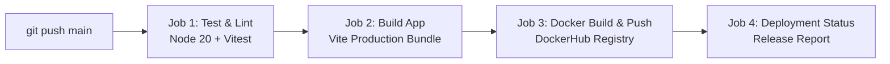

# 🚀 TASK 1: Automate Code Deployment Using CI/CD Pipeline (GitHub Actions)

> **Objective:** Set up an end-to-end CI/CD pipeline to automate testing, building, and deploying a modern containerized web application to **DockerHub** using **GitHub Actions**.

---

## 🌟 Unique Front-End Concept: TaskPulse • Personal DailyTask Alert Engine
Built with **React**, **Vite**, and **Modern Glassmorphism UI**, **TaskPulse** is a personal daily focus and task reminder dashboard featuring:
- 🔔 **Synthesized Audio Chimes**: Dual harmonic and urgent arpeggio tones using HTML5 Web Audio API (zero external MP3 assets).
- ⚡ **Live Ambient Countdown**: Second-by-second countdown to the next scheduled alert.
- 🚨 **Priority Alert System**: `CRITICAL`, `HIGH`, `MEDIUM`, and `LOW` priorities with dynamic pulsing glow animations.
- ⏰ **Interactive Alert Simulator**: One-click "Test Alert" button to instantly preview sound, visual alert banners, and action modals.
- 💧 **Daily Habits & Sprint Tracking**: Categories for Work, Coding, Health, and Personal routines.
- 🎯 **Browser Push Notifications**: Desktop alerts using the HTML5 Notification API.
- 🎉 **Confetti Celebration**: Rewarding visual feedback upon task completion.

---

## 🛠️ Technology Stack & Tools

| Component | Technology | Description |
|---|---|---|
| **Frontend Framework** | React 19 (Vite) | High-performance SPA with modern React hooks & state |
| **Styling** | Vanilla CSS Glassmorphism | Custom design system with dark cyber palette & micro-animations |
| **Testing** | Vitest & React Testing Library | Automated unit tests ensuring zero broken builds in CI |
| **Containerization** | Docker & Docker Compose | Multi-stage build (`node:20-alpine` ➔ `nginx:alpine`) |
| **Web Server** | Nginx Alpine | Serves production build with Gzip, security headers & health checks |
| **CI/CD Orchestration** | GitHub Actions | Automated pipeline defined in `.github/workflows/main.yml` |
| **Container Registry** | DockerHub | Automated image building, tagging (`latest`, `${{ github.sha }}`) and pushing |

---

## 🏗️ CI/CD Pipeline Architecture (`.github/workflows/main.yml`)

The automated pipeline triggers on every `push` to the `main` branch, `pull_request` to `main`, or manual trigger (`workflow_dispatch`).



### 📋 Pipeline Stages

1. **Stage 1: Test & Lint (`test-and-lint`)**
   - Checks out the repository.
   - Sets up Node.js 20 with `npm` dependency caching.
   - Executes `npm ci` and runs the automated test suite (`npm test`).
   - If tests fail, the pipeline halts immediately, preventing faulty code deployment.

2. **Stage 2: Build Application (`build-application`)**
   - Compiles the React application into production-optimized assets (`dist/`).
   - Generates and uploads a build artifact (`taskpulse-production-dist`) accessible in the GitHub Actions run summary.

3. **Stage 3: Docker Build & Push (`docker-build-and-push`)**
   - Configures QEMU and Docker Buildx for multi-platform support.
   - Authenticates with DockerHub using encrypted repository secrets (`DOCKERHUB_USERNAME`, `DOCKERHUB_TOKEN`).
   - Extracts commit SHA and branch metadata.
   - Builds the production multi-stage Docker image and pushes tags:
     - `${{ secrets.DOCKERHUB_USERNAME }}/personal-dailytask-alert:latest`
     - `${{ secrets.DOCKERHUB_USERNAME }}/personal-dailytask-alert:${{ github.sha }}`
   - Utilizes GitHub Actions cache (`type=gha`) for fast Docker layer rebuilds.

4. **Stage 4: Deployment Status Verification (`deployment-status`)**
   - Emits a deployment report to the GitHub Actions Job Summary with commit hash, branch, and DockerHub image tags.

---

## 🔑 Setting up GitHub Repository Secrets

To enable DockerHub automated image pushing:

1. **Create DockerHub Access Token:**
   - Log in to [hub.docker.com](https://hub.docker.com/).
   - Go to **Account Settings ➔ Security ➔ Personal access tokens**.
   - Click **Generate new token** with `Read & Write` permissions.
   - Copy the token value.

2. **Add Secrets to GitHub Repository:**
   - Go to your GitHub repository: **Settings ➔ Secrets and variables ➔ Actions**.
   - Click **New repository secret**:
     - `DOCKERHUB_USERNAME`: Your DockerHub username.
     - `DOCKERHUB_TOKEN`: The Personal Access Token generated above.

---

## 💻 Local Development & Testing

### 1. Run in Development Mode
```bash
# Install dependencies
npm install

# Start local Vite dev server
npm run dev
```
Open [http://localhost:5173](http://localhost:5173) in your browser.

### 2. Run Automated Test Suite
```bash
# Execute unit tests with Vitest
npm test
```

### 3. Production Build Check
```bash
# Build production bundle
npm run build
```

---

## 🐳 Running with Docker Locally

### Option A: Using Docker Compose (Recommended)
```bash
docker compose up --build
```
Access the application at [http://localhost:8080](http://localhost:8080).

### Option B: Using Docker CLI
```bash
# 1. Build Docker image
docker build -t personal-dailytask-alert .

# 2. Run container
docker run -d -p 8080:80 --name taskpulse-app personal-dailytask-alert

# 3. Check health status
docker inspect --format='{{json .State.Health}}' taskpulse-app
```

---

## 📂 Project Repository Structure

```
.
├── .github/
│   └── workflows/
│       └── main.yml           # GitHub Actions CI/CD Pipeline definition
├── public/
│   └── alarm-clock.svg        # Application favicon
├── src/
│   ├── components/
│   │   ├── ActiveAlertBanner.jsx # Glowing top alert notification
│   │   ├── CiCdInfoModal.jsx     # In-app CI/CD architecture modal
│   │   ├── Navbar.jsx            # Live clock, mute toggle, test alert button
│   │   ├── NewTaskModal.jsx      # Task creation with custom alert presets
│   │   ├── StatsBar.jsx          # Metrics overview (tasks, alerts, streak)
│   │   ├── TaskAlertModal.jsx    # Pop-up modal when alert time triggers
│   │   ├── TaskCard.jsx          # Individual task card with audio preview
│   │   └── TaskFilter.jsx        # Search, status pills, and category filter
│   ├── utils/
│   │   └── audioAlert.js         # Web Audio API alert chime synthesizer
│   ├── App.jsx                   # Main application state & alert engine
│   ├── App.test.jsx              # Automated Vitest test suite
│   ├── index.css                 # Glassmorphic cyber design system
│   ├── main.jsx                  # React application entry point
│   └── setupTests.js             # Vitest DOM matchers setup
├── .dockerignore                 # Excluded build context patterns
├── .gitignore                    # Git ignored files
├── docker-compose.yml            # 1-command container orchestration
├── Dockerfile                    # Multi-stage production Docker build
├── index.html                    # HTML5 template with Google Fonts
├── nginx.conf                    # Nginx SPA server configuration
├── package.json                  # Dependencies, test & build scripts
├── vite.config.js                # Vite & Vitest configuration
└── README.md                     # Project documentation & CI/CD guide
```

---

## 🎯 Deliverables Checklist

- [x] Complete Node.js / React Web Application with unique "personal-dailytask" alert design.
- [x] Automated Unit Test Suite (`npm test`) integrated with Vitest.
- [x] Multi-Stage `Dockerfile` with Nginx production serving, security headers & health checks.
- [x] `docker-compose.yml` for 1-command containerized execution.
- [x] Complete `.github/workflows/main.yml` with:
  - [x] Trigger on `push` to `main`.
  - [x] Job 1: Automated Unit Testing (`test-and-lint`).
  - [x] Job 2: Production Bundle Compilation (`build-application`).
  - [x] Job 3: DockerHub Login, Buildx Multi-platform Build & Push (`docker-build-and-push`).
  - [x] Job 4: Release Deployment Summary (`deployment-status`).
- [x] Thorough documentation covering GitHub Secrets, local Docker commands, and architecture diagrams.
